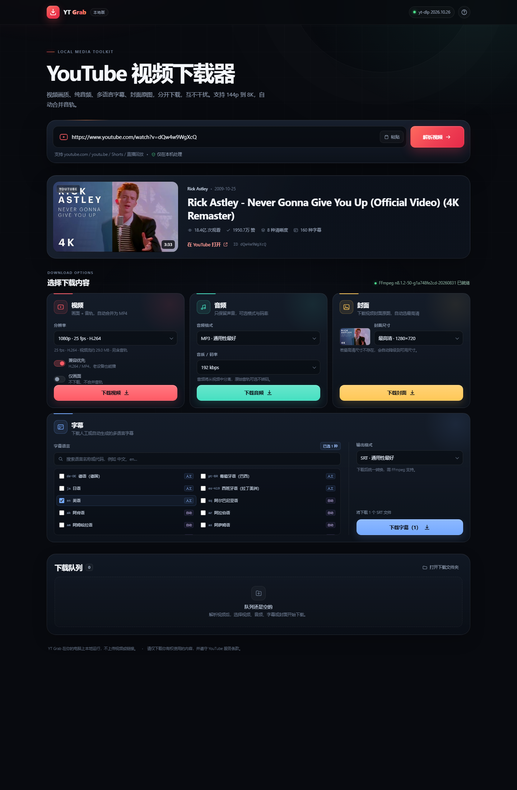

# YT Grab · YouTube 视频下载器

一个在**本机运行**的 YouTube 下载工具。粘贴一个视频链接，即可：

- 按实际可用分辨率下载视频（144p / 360p / 720p / 1080p / 1440p / 4K / 8K）；
- 自动合并画面与音轨，默认输出兼容性更好的 MP4；
- 单独提取音频，支持 MP3、M4A、Opus、WAV 和「原始音轨不转码」；
- 下载**多语言字幕**，支持人工字幕、自动字幕和自动翻译，输出 SRT / VTT；
- 单独下载视频封面，支持最高清、高清、标准、小图四种尺寸；
- 下载**无声视频**（仅画面，不含音轨）；
- 在页面内查看实时进度、速度、剩余时间，支持取消任务；
- 文件保存到本地 `downloads` 文件夹，重复下载不覆盖旧文件。

界面使用原生 HTML / CSS / JavaScript，后端只依赖 Python 标准库和 `yt-dlp`，无需安装 Flask、Node.js 或其他框架。首次启动时 `start.bat` 会自动把 yt-dlp 安装到 `vendor` 目录；该目录不会提交到 Git 仓库。



---

## 快速开始

### 环境要求

| 组件 | 要求 | 说明 |
| --- | --- | --- |
| Windows | Windows 10 / 11 | 其他系统也可运行，但启动脚本针对 Windows 编写 |
| Python | 3.11 或更高版本 | 安装时勾选 **Add Python to PATH** |
| FFmpeg | 需要 | 用于合并 1080p 以上视频、转换音频/字幕格式 |
| yt-dlp | 首次启动自动安装 | 安装到 `vendor/yt_dlp`，不需要手动处理 |

### 启动

1. 双击 **`start.bat`**。如果从 GitHub 源码运行且没有 `vendor` 目录，首次启动会自动联网安装 yt-dlp（约几 MB）；完整压缩包已包含该依赖，会直接启动。
2. 程序会自动打开浏览器，地址通常是 <http://127.0.0.1:8765>。
3. 粘贴 YouTube 链接 → 点击「解析视频」。
4. 在视频 / 音频 / 封面 / 字幕卡片中选择参数，点击对应的下载按钮。
5. 在「下载队列」查看进度；完成后点击文件夹图标定位文件。

> 启动窗口会一直保持打开，关闭窗口或按 `Ctrl+C` 即停止服务。若启动失败，窗口会停留并显示错误码，不会一闪而过。

> 如果 8765 端口被占用，程序会自动尝试 8766、8767…… 并在黑色运行窗口中显示实际地址。

### 没有 FFmpeg？

任选一种方式：

```powershell
winget install --id Gyan.FFmpeg -e
```

或从 [ffmpeg.org](https://ffmpeg.org/download.html) 下载 Windows 构建，把 `ffmpeg.exe` 放到：

```text
yt_download\bin\ffmpeg.exe
```

程序会自动识别 PATH 中的 FFmpeg、Winget 安装目录以及 `bin\ffmpeg.exe`。安装后重启 `start.bat`。

没有 FFmpeg 时仍可下载封面和「仅画面」视频，但无法合并音轨、提取音频或转换字幕格式。

---

## 功能说明

### 视频分辨率

解析后会读取该视频**实际提供**的视频流，而不是写死的选项。下拉框中会显示分辨率、帧率、编码和 HDR 标记，例如：

```text
1080p · 25 fps · H.264
2160p · 4K · 60 fps · VP9 · HDR
```

- 默认选择 1080p；没有 1080p 时选择不高于 1080p 的最高分辨率。
- 「最佳画质」会自动选择最高可用视频流。
- **兼容优先**默认开启，优先选择 H.264 视频 + AAC 音频，适合老设备、电视和剪辑软件。
- 取消「兼容优先」后允许 AV1 / VP9，同画质下文件通常更小，但部分老设备无法播放。
- 勾选「仅画面」则只下载视频流，不下载、不合并音轨。

> 1080p 及以上的 YouTube 视频通常把画面和声音分开存放，必须用 FFmpeg 合并。合并发生在下载完成后，4K / 8K 可能等待较久。

### 音频

| 格式 | 说明 |
| --- | --- |
| MP3 | 通用性最好，可选 320 / 256 / 192 / 128 kbps |
| M4A | AAC 封装，适合苹果设备和大多数播放器 |
| Opus | 同码率下体积更小、音质更好，适合网页和移动端 |
| WAV | 无损容器，文件很大，适合后期处理 |
| 原始音轨 | 不转码，保留 YouTube 提供的最佳音频流（通常是 Opus / AAC） |

### 字幕

字幕卡片会列出视频可用的语言：

- **人工字幕**：视频上传者提供的字幕，优先显示。
- **自动字幕**：YouTube 语音识别生成的字幕。
- **自动翻译**：自动字幕的翻译版本，数量可能上百种；默认隐藏，可勾选「显示自动翻译」或直接搜索语言名/语言代码。
- 支持一次勾选多种语言，最多 20 种。
- 输出格式可选 **SRT** 或 **VTT**，需要 FFmpeg 转换。
- 文件按语言分别保存，例如：

```text
视频标题 [视频ID].en.srt
视频标题 [视频ID].zh-Hans.srt
```

> 如果部分语言被 YouTube 限流（HTTP 429），已经成功下载的语言会保留，队列会显示“部分完成”的提示。可以等待几分钟后减少语言数量重试。

### 封面

默认选择「最高清」。YouTube 的 `maxresdefault` 封面并非每个视频都有，程序会自动按以下顺序降级：

```text
最高清 → 高清 → 标准 → 小图
```

下载的封面是原始 JPEG 图片，文件名形如：

```text
视频标题 [视频ID] - cover.jpg
```

### 文件命名与保存

- 默认目录：`downloads\`
- 视频：`视频标题 [视频ID] - 1080p.mp4`
- 音频：`视频标题 [视频ID].mp3`
- 字幕：`视频标题 [视频ID].en.srt`
- 封面：`视频标题 [视频ID] - cover.jpg`
- 同名文件已存在时自动添加 `(2)`、`(3)`，不会覆盖旧文件。

---

## 常见问题

### 双击 `start.bat` 后窗口一闪而过

先确认是**解压后**再双击，不要直接在压缩包预览窗口中运行。若仍闪退，打开「命令提示符」，执行：

```bat
cd /d "解压后的目录"
start.bat
```

这样错误信息会保留在窗口里。当前版本已把批处理改成 Windows 换行，并在退出时执行 `pause`，一般不会自动关闭。

### 提示「YouTube 要求确认你不是机器人」

YouTube 对部分网络（尤其是机房 / 代理 IP）会要求登录验证。解决办法：

1. 在浏览器中登录 YouTube；
2. 使用浏览器扩展（如 “Get cookies.txt LOCALLY”）导出 **Netscape 格式**的 `cookies.txt`；
3. 把文件放到程序目录（与 `app.py` 同级）；
4. 刷新页面后重试。

也可以设置环境变量，让 yt-dlp 直接读取浏览器 Cookie：

```bat
set YTDLP_COOKIES_FROM_BROWSER=edge
start.bat
```

Chrome 用 `chrome`，Firefox 用 `firefox`，Edge 用 `edge`。

> `cookies.txt` 等同于账号登录凭据，请勿分享或上传到代码仓库。项目已在 `.gitignore` 中忽略它。

### 下载 403 / 格式不可用

先运行 **`update-ytdlp.bat`** 更新下载引擎。YouTube 会不定期修改接口，旧版 yt-dlp 常出现 403 或格式解析失败。

### 需要代理

设置环境变量后启动：

```bat
set YTDLP_PROXY=http://127.0.0.1:7890
start.bat
```

也支持 `socks5://127.0.0.1:7891` 等 yt-dlp 支持的代理格式。

### 端口被占用 / 浏览器没有自动打开

查看运行窗口里打印的「网页地址」，手动复制到浏览器。也可以指定端口：

```bat
python app.py --port 9000 --open
```

### 想更换下载目录

目前默认保存到程序目录下的 `downloads`。如需修改，可调整 `ytdl_core.py` 顶部的 `DOWNLOAD_DIR`，或把整个程序放到希望保存的位置。

---

## 更新 yt-dlp

双击 **`update-ytdlp.bat`**。它会在 `vendor` 目录中安装最新版 yt-dlp，不会影响系统 Python 环境。

手动更新：

```bat
python -m pip install --upgrade --target vendor yt-dlp
```

---

## 项目结构

```text
yt_download/
├─ app.py                 # 启动入口、端口选择
├─ server.py              # 本地 HTTP 服务与 JSON API
├─ ytdl_core.py           # yt-dlp 调用、格式解析、任务队列、封面下载
├─ start.bat              # 双击启动（首次运行自动安装 yt-dlp）
├─ update-ytdlp.bat       # 更新下载引擎
├─ requirements.txt       # 可选：开发环境依赖
├─ vendor/yt_dlp/         # 首次启动自动生成，不提交 Git
├─ web/
│  ├─ index.html
│  ├─ style.css
│  ├─ app.js
│  └─ favicon.svg
├─ docs/preview.png       # 界面预览图
├─ downloads/             # 下载结果
├─ work/                  # 临时下载目录（自动清理）
└─ cookies.txt            # 可选：登录凭据（不要提交）
```

### HTTP API（可选）

服务只监听 `127.0.0.1`，仅供本机页面使用。调试时也可以直接调用：

| 方法 | 路径 | 作用 |
| --- | --- | --- |
| GET | `/api/health` | 引擎、FFmpeg、Cookie 状态 |
| POST | `/api/info` | 解析视频，body：`{"url": "..."}` |
| POST | `/api/download` | 创建下载任务 |
| GET | `/api/jobs` | 获取任务队列 |
| GET | `/api/jobs/<id>` | 获取单个任务 |
| POST | `/api/jobs/<id>/cancel` | 取消任务 |
| POST | `/api/open-folder` | 打开下载目录或定位文件 |
| GET | `/api/thumbnail/<videoId>?q=maxres` | 封面代理 |

下载请求示例：

```json
{
  "url": "https://www.youtube.com/watch?v=XXXXXXXXXXX",
  "title": "视频标题",
  "kind": "video",
  "height": 1080,
  "compat": true,
  "muted": false
}
```

`kind` 可为 `video`、`audio`、`thumbnail`、`subtitle`。音频额外传 `audio_format` 和 `audio_quality`，封面传 `thumb_quality`。

字幕请求示例：

```json
{
  "url": "https://www.youtube.com/watch?v=XXXXXXXXXXX",
  "title": "视频标题",
  "kind": "subtitle",
  "languages": ["en", "zh-Hans"],
  "manual_languages": ["en"],
  "auto_languages": ["zh-Hans"],
  "subtitle_format": "srt"
}
```

`languages` 是全部选中的语言，`manual_languages` 和 `auto_languages` 用于区分人工/自动字幕。可先调用 `/api/info`，读取返回的 `subtitle_languages` 获得语言代码。

---

## 设计说明与限制

- **单视频**：当前只处理单个视频链接，不展开播放列表或频道。
- **直播**：不支持正在直播的流；直播结束后可下载回放。
- **并发**：最多同时进行 2 个下载任务，超出的任务排队。
- **任务状态在内存中**：关闭程序后队列历史会清空，但已完成的文件仍在 `downloads` 中。
- **仅本机访问**：服务绑定 `127.0.0.1`，并校验 `Host` / `Origin`，避免局域网或网页跨站调用。
- **无账号体系**：程序不上传链接、Cookie 或下载内容；所有请求从本机直接发往 YouTube。
- **不绕过版权保护**：仅用于下载你有权保存的内容。请遵守 YouTube 服务条款及所在地区法律。

---

## 许可证与第三方组件

- 本项目代码可自由修改和使用。
- [yt-dlp](https://github.com/yt-dlp/yt-dlp) 以 Unlicense 发布，已内置于 `vendor/yt_dlp`。
- FFmpeg 为独立可执行程序，遵循其各自的许可证（GPL / LGPL，取决于构建版本），本项目不将其打包分发。
